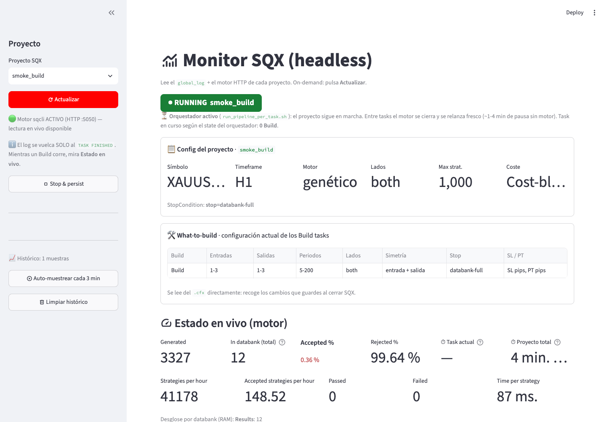

# sqx-headless

Lanza, vigila y para proyectos de **StrategyQuant X** (custom projects) **sin abrir la GUI**, en macOS.

> **English:** run, monitor and stop StrategyQuant X custom projects headless on macOS, with a fresh
> `sqcli` engine per task, a browser monitor and a safe "stop & persist". The docs are in Spanish;
> issues and pull requests in English are welcome. Unofficial tool, not affiliated with StrategyQuant.

- **Pipelines largos sin quedarse sin memoria.** Un proyecto con Build → Retests → Filtros se ejecuta
  task a task, con un motor de SQX nuevo para cada una. Con un único motor, la RAM se acumula
  hasta que el Mac colapsa.
- **Seguimiento desde el navegador.** Un monitor muestra el estado de cada task, los databanks, la
  evolución del fitness y los motivos de rechazo, sin tocar la GUI.
- **Parar sin perder estrategias.** Los databanks se guardan a disco antes de matar el motor, y el
  proyecto queda listo para abrirlo en la GUI.

Los proyectos se siguen creando y configurando en la GUI de SQX. Esto solo los ejecuta.

## Empieza aquí

1. **Una vez**: instala (*Instalación*, abajo) y ajusta la memoria del motor (*Ajustar a tu Mac*).
2. **Con la GUI de SQX cerrada**, abre el monitor: `caffeinate -i streamlit run sqx/sqx_monitor.py`.
3. **En el navegador**: elige el proyecto → *Ejecutar task*, la primera task (índice 0) en modo "desde
   esta" → **Actualizar** para ver cómo va → **Stop & persist** para parar guardando.



**Guía paso a paso con capturas**: `open docs/guia.html` (se abre en el navegador; GitHub muestra el
código de la página, no la página).

> **Herramienta no oficial**, sin relación con StrategyQuant s.r.o. (StrategyQuant X es marca suya).
> Necesitas tu propia licencia de SQX: este repo no incluye ni modifica SQX, solo usa su motor de
> línea de comandos (`sqcli`) y su API HTTP. **Úsalo bajo tu responsabilidad** (licencia MIT, sin
> garantía): los scripts paran procesos de SQX, desactivan tasks del `.cfx` mientras corren (con
> copia y restauración) y pueden apartar databanks (los mueven, no los borran). Prueba primero con
> un proyecto clonado.

## Requisitos

- **macOS** (probado en Apple Silicon con SQX **build 144**). No funciona en Windows.
- **git** (si no lo tienes, `xcode-select --install`).
- **StrategyQuant X** instalado en `/Applications` o `~/Applications`, con la licencia activa. El
  motor de línea de comandos (`sqcli`) viene dentro de la app.
- **Python 3.11**: `brew install python@3.11` o el instalador de python.org.
- **RAM**: el motor carga en memoria **todos** los databanks del proyecto (unos 0,9 GB por cada
  1.000 estrategias). La configuración de referencia es un Mac de 16 GB (ver *Ajustar a tu Mac*).

## Instalación (una vez)

```bash
git clone https://github.com/sergiobe31/sqx-headless.git
cd sqx-headless
python3.11 -m venv .venv
source .venv/bin/activate
pip install -r requirements.txt
mkdir -p sqx/output
python sqx/paths.py        # comprueba que encuentra tu SQX
```

`python sqx/paths.py` muestra la app que va a usar y comprueba que `sqcli` y `user/projects`
existen. Si tienes **varias** instalaciones de SQX, elige una con
`export SQX_APP=/Applications/StrategyQuantX<versión>.app` (y ponlo en tu `~/.zshrc`).

**Activa el entorno en cada terminal nueva** (`source .venv/bin/activate`). Los scripts llaman a
`python3`, y tiene que ser el de `.venv`.

## Ajustar a tu Mac (una vez)

1. **Memoria del motor.** `-Xmx` es la memoria máxima que puede usar el motor. SQX trae `-Xms4g` sin `-Xmx` en
   `/Applications/StrategyQuantX….app/Contents/Resources/sqcli.config`, así que el heap máximo
   queda en el 25 % de la RAM y los proyectos grandes revientan. La configuración de referencia
   (Mac de 16 GB) es esta:
   ```
   option -Xms1g
   option -Xmx6g
   option -XX:+UseG1GC
   ```
   Edítalo **con SQX cerrado y sin ninguna corrida en marcha**. Guarda antes una copia
   (`cp sqcli.config sqcli.config.bak`) y usa un editor que respete los finales de línea del
   fichero. La GUI tiene su propio fichero, `StrategyQuantX.config`; la referencia usa
   `-Xms4g -Xmx10g`. Repite este paso cada vez que reinstales SQX.
2. **Vigilante de RAM.** Mientras corre una task, el driver mide la memoria del motor. Avisa a
   los 8 GB y lo para a los 9 GB, o cuando la RAM libre del Mac baja del 10 %. Esos valores
   están pensados para el Mac de 16 GB. Si tienes más RAM y has subido el `-Xmx`, sube también
   los umbrales en tu `~/.zshrc`. Como orientación, sin medir: el umbral de parada ≈ `-Xmx` + 3 GB.
   ```bash
   export WD_WARN_RSS_MB=14336   # ejemplo para -Xmx12g en un Mac de 32 GB
   export WD_KILL_RSS_MB=15360
   ```
   Las variables tienen que estar puestas **antes** de lanzar: abre una terminal nueva (o
   `source ~/.zshrc`) y, si lanzas desde el monitor, reinícialo.
   Cuando el vigilante para el motor **no guarda**: se pierde lo generado desde el último sondeo.
   La task queda marcada como fallida por RAM y el pipeline indica desde dónde reanudar.

## Uso

### Antes de lanzar nada

- **GUI de SQX cerrada.** GUI y motor no pueden convivir: abrir la GUI con el motor vivo
  **corrompe databanks** (caso real: `Results` pasó de 4.000 a 136 estrategias).
- **Ningún motor vivo**: `pgrep -x sqcli` no debe devolver nada. Entre tasks, el orquestador
  remata el motor de su propia task anterior si tarda en morir; un motor de **otra** corrida no lo
  toca nunca: espera 2 minutos y aborta diciéndote cómo pararlo.
- **Los databanks que crees tú, sin espacios en el nombre.** Los bancos con espacios no se guardan
  por HTTP. Los de SQX que llevan espacios (`Initial population`, `Last generation`…) no se pueden
  renombrar: el driver los deja a su auto-sync.
- **Mac despierto, enchufado y con la tapa abierta.** Si el Mac se duerme, el motor se congela o
  muere. `caffeinate -i` evita que se duerma por inactividad, pero no al cerrar la tapa.

### 1. Ver las tasks del proyecto

```bash
python sqx/run_task_headless.py MiProyecto --list
```

El índice que sale (0, 1, 2…) es el que usan los demás comandos para decir "desde la task N".

Quién hace qué: el **orquestador** (`run_pipeline_per_task.sh`) recorre las tasks del proyecto y lanza
cada una; el **driver** (`run_pipeline_headless.sh`) lleva una task: arranca el motor, la vigila, guarda
los databanks y cierra el motor.

### 2. Lanzar

```bash
# Pipeline completo, un motor por task, en segundo plano y con el Mac despierto:
nohup caffeinate -i bash sqx/run_pipeline_per_task.sh MiProyecto > sqx/output/MiProyecto_launch.log 2>&1 &

# Desde la task 3 (índice de --list), archivando los bancos que cada task no usa (menos RAM):
nohup caffeinate -i bash sqx/run_pipeline_per_task.sh MiProyecto 3 --slim > sqx/output/MiProyecto_launch.log 2>&1 &

# Una sola task (el comando vuelve enseguida y la task sigue en segundo plano;
# deja `caffeinate -i` abierto en otra terminal mientras dure):
python sqx/run_task_headless.py MiProyecto --task "Nombre de la task" --mode only
```

- **`--slim`** sirve para proyectos con databanks grandes (miles de estrategias). Mientras corre
  cada task, aparta los bancos que esa task no usa y al final los devuelve a su sitio. No se
  borra nada. El índice y `--slim` van en cualquier orden (`MiProyecto --slim` = desde la task 0).
- Si una task falla, el pipeline **se detiene e indica el índice** desde el que reanudar (última
  línea `ABORT … Reanuda: …` del log de lanzamiento). Vuelve a lanzar con ese índice.
- Para varios proyectos seguidos con la misma estructura de tasks (no admite `--slim`):
  `nohup caffeinate -i bash sqx/run_cascade_projects.sh 0 ProyectoA ProyectoB > sqx/output/cascada_launch.log 2>&1 &`.
  Si un proyecto falla, la cascada sigue con el siguiente; si lo paras tú (Stop & persist), se
  detiene entera.
- Cada task tiene un tope de 12 h (`MAXITER`=48 sondeos de 15 min). Para tasks más largas, sube
  `MAXITER` (por ejemplo `MAXITER=96`).
- Para retests cortos (unos minutos), lanza con `POLL_MIN=2`; si no, el driver tarda hasta 15 min
  en darse cuenta de que la task terminó. Con `POLL_MIN` bajo, sube también `MAXITER`
  (por ejemplo `MAXITER=600 POLL_MIN=1`). Ojo: en cada sondeo el driver guarda todos los bancos
  a disco, así que `POLL_MIN` bajo solo es buena idea con bancos pequeños.

### 3. Vigilar

```bash
caffeinate -i streamlit run sqx/sqx_monitor.py
```

Se abre en el navegador. Eliges el proyecto y pulsas **Actualizar**. Desde la barra lateral
también puedes **ejecutar una task** (modo "desde esta" = pipeline con un motor por task),
**parar y guardar**, y activar el auto-muestreo cada 3 min, que sigue funcionando aunque cierres
el monitor.

Si lanzas desde el monitor, basta con mantener abierta la terminal del monitor (la de `caffeinate`):
mientras siga abierta, el Mac no se duerme por inactividad. En ese caso el log del orquestador queda en
`/tmp/<proyecto>_pertask_<hora>.log` (macOS limpia `/tmp` al reiniciar).
Mientras el motor arranca y carga los databanks, y en la pausa de 1-4 min entre tasks, el monitor
muestra **EN PROCESO · motor en pausa** con la task en curso, y no deja lanzar otro pipeline mientras
siga vivo.

Dónde queda cada cosa:

| Qué | Dónde |
| --- | --- |
| Logs de cada task y CSV por databank (los exporta el driver al terminar cada task) | `sqx/output/<proyecto>_<fecha>/` |
| Memoria del motor (cada 30 s) | `sqx/output/<proyecto>_telemetry.csv` |
| Estado de cada task (pendiente / en curso / hecha / fallida) | `sqx/output/<proyecto>_state.json` |
| Log del propio SQX | `…/user/projects/<proyecto>/log/global_log_*.log` |
| Las estrategias guardadas (`.sqx`) | `…/user/projects/<proyecto>/databanks/<banco>/` (dentro de la carpeta de SQX) |
| Histórico del monitor | `~/.sqx_monitor/` |

### 4. Parar

Botón **Stop & persist** del monitor, o:

```bash
python sqx/stop_and_persist.py MiProyecto
```

- **Con un pipeline en marcha, lo para entero**: le pide al motor que pare la task en curso, el
  driver guarda los databanks (y confirma cada guardado en el log del motor) y el orquestador no
  lanza ninguna task más. En su log verás `⏹ PARADA por el usuario en la task N … Reanuda: …`
  (código de salida 3) en el log de lanzamiento (`sqx/output/<proyecto>_launch.log`, o el de `/tmp`
  si lanzaste desde el monitor). Para seguir más tarde, relanza con ese índice para repetir la task
  parada, o con el siguiente para darla por buena con lo que ya guardó. Qué pasa con las
  estrategias de una task repetida depende de cómo esté configurada en SQX, igual que en la GUI.
- **Sin pipeline** (un motor suelto): para el proyecto, espera a que terminen de cargar los bancos,
  los guarda y mata el motor. Si el motor no responde por HTTP, mira la CPU: si está trabajando
  **no lo mata** (si sabes que está colgado, `--force-kill`); si un guardado falla, tampoco lo mata.
- El botón del monitor espera hasta 3 minutos. Si la task tarda más en guardar, el reporte dice
  "parando" y el pipeline se detiene igual al terminar de guardar. Por CLI, `--wait-secs` (30 min
  por defecto).
- Al final te dice si ya es seguro abrir la GUI, o por qué no. Si dice que es seguro, puedes
  abrirla; `persist_before_gui.py` (paso 5) es la comprobación para cualquier otro momento.

**Nunca mates `sqcli` a mano sin guardar antes**: lo que no esté en disco se pierde.

### 5. Antes de abrir la GUI

```bash
python sqx/persist_before_gui.py MiProyecto
```

Solo **comprueba** (no arranca el motor ni toca nada): que no haya motor, GUI, pipeline ni cascada
vivos, ni bancos apartados por `--slim`, ni un `.cfx` a medio restaurar. Muestra los `.sqx` en
disco y sale con código 0 si es seguro abrir la GUI, o 1 con los motivos.

- Con el motor vivo: primero Stop & persist (paso 4).
- Si una corrida con `--slim` murió a medias y quedan bancos apartados:
  `python sqx/bank_plan.py MiProyecto --reconcile` (o relanza el pipeline: reconcilia al arrancar).
- El driver solo dice "Ya puedes abrir la GUI" en una task suelta y cuando de verdad es seguro; a
  mitad de pipeline nunca.

## Otras herramientas

| Comando | Para qué |
| --- | --- |
| `python sqx/gui_slim.py <proy> archive --banks A,B` / `restore` / `status` | Apartar bancos pesados para que la GUI abra rápido (los mueve, no borra) |
| `python sqx/show_reject_breakdown.py <proy>` | Por qué se rechazaron las estrategias del último Build |
| `python sqx/inspect_build_tasks.py <proy>` | Qué configura cada Build task del proyecto |
| `python sqx/pass_matrix.py --dir sqx/output/<proy>_<fecha>` | Matriz estrategia × prueba (PASSED/FAILED) a partir de los CSV |
| `python sqx/retry_project.py plan\|build\|export\|merge …` | Volver a pasar solo las pruebas que faltan en la matriz |

## Si algo va mal

| Síntoma | Qué hacer |
| --- | --- |
| `ABORT: ya hay un sqcli corriendo` o `hay un motor sqcli que no es de esta cadena` | Queda un motor vivo (`pgrep -x sqcli`) de otra corrida. Si no hay nada tuyo en marcha: `python sqx/stop_and_persist.py <proy>` y relanza con el índice que indique el mensaje. |
| `sync de <banco> NO confirmado: dejo el motor vivo` | El guardado final no se pudo confirmar y el driver dejó el motor vivo para no perder nada; la task queda fallida y el pipeline se detiene. Ejecuta `python sqx/stop_and_persist.py <proy>`, que reintenta el guardado, y revisa los `.sqx` en `…/user/projects/<proy>/databanks/<banco>/`. No abras la GUI ni mates `sqcli` antes. |
| El Mac se durmió durante la corrida | Lo guardado es lo del último sondeo (cada 15 min). Al despertar, pulsa **Actualizar** en el monitor: si el motor murió, el pipeline aborta e indica el índice desde el que reanudar. |
| El pipeline abortó con un índice | El índice está en la última línea `ABORT … Reanuda:` del log de lanzamiento. La causa, en `sqx/output/<proy>_state.json` y en `sqx/output/<proy>_<fecha>/task_<n>_<nombre>/`. Relanza con ese índice. |
| Una task "termina" en segundos con 0 estrategias | Su databank de entrada estaba vacío o no está declarado en el proyecto. Ver `docs/persistencia-databanks.md`. |
| El monitor avisa de **Restore pendiente** | Un lanzamiento murió a mitad y el `.cfx` puede tener tasks desactivadas. Pulsa *Restaurar .cfx original*. |
| El motor no responde pero sigue vivo | `ps -o pid,%cpu,etime -p "$(pgrep -x sqcli)"` varias veces. CPU alta = trabajando: espera. CPU < 5 % sostenida = colgado: `kill -9 <PID>` (se pierde lo no guardado). Si hay un pipeline en marcha, deja que el driver lo resuelva. `stop_and_persist.py` aplica la misma regla. |
| La GUI tarda mucho en abrir o se congela | Demasiadas estrategias en los bancos: usa `gui_slim.py archive`. |

## Usarlo con una IA

El repo trae `AGENTS.md` (y `CLAUDE.md`, que lo importa) con las reglas de operación y las trampas
conocidas. Abre la carpeta en Claude Code, Codex, Cursor o similar, y la IA las cargará. Ejemplos
de peticiones:

- *"Lista las tasks de MiProyecto y lánzalo desde la 3 con `--slim`, con el Mac despierto."*
- *"El pipeline de MiProyecto ha abortado: mira los logs y dime desde dónde reanudar."*
- *"Para MiProyecto y deja los databanks listos para abrir la GUI."*

La IA debe pedirte confirmación antes de parar o matar procesos, mover bancos o editar un `.cfx`.

## Documentación

| Doc | Cuándo leerlo |
| --- | --- |
| `docs/guia.html` | Guía paso a paso con capturas del monitor (ábrela en el navegador) |
| `AGENTS.md` | Reglas de operación y trampas (también vale para personas) |
| `docs/sqx_cli_commands.md` | Referencia de `sqcli` y anatomía de un `.cfx` |
| `docs/memoria-heap.md` | Problemas de RAM, `--slim`, vigilante, motor colgado |
| `docs/persistencia-databanks.md` | Guardar, sincronizar y exportar databanks; bancos que "desaparecen" |
| `docs/cascadas.md` | Varios proyectos seguidos; corridas desatendidas |
| `docs/version-b144.md` | Diferencias entre B143 y B144 |

## Contribuir

Los fallos, como issue (con macOS, build de SQX y logs; nunca estrategias). Los PRs son bienvenidos
y se revisan aquí. Este repo es el espejo público de un repo de trabajo privado: los cambios
aceptados se integran también allí para que la siguiente instantánea no los pise. Detalles, y lo
que implicaría una versión para Windows, en [CONTRIBUTING.md](CONTRIBUTING.md).

## Licencia

[MIT](LICENSE). Herramienta no oficial, sin relación con StrategyQuant s.r.o.

## Tests

```bash
pip install -r requirements-dev.txt
python -m pytest -q
```

No necesitan SQX: usan un motor simulado, procesos de prueba y carpetas temporales. Tardan entre 10 y 25
minutos según el Mac.
